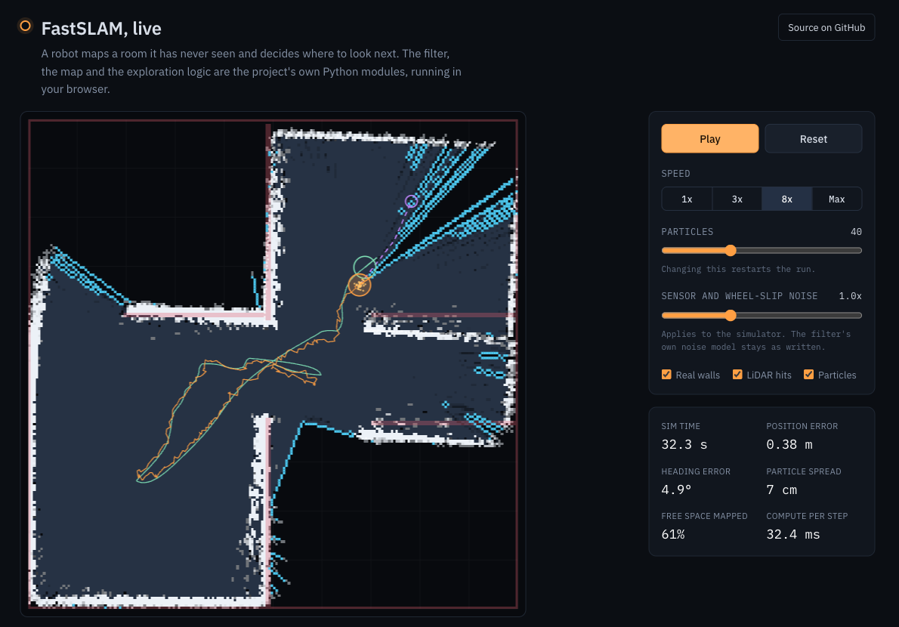

# Probabilistic SLAM with Autonomous Exploration

A particle-filter SLAM system, written from scratch in Python, that lets a simulated robot map a building it has never seen and choose where to explore next.

[](https://github.com/Ramy3077/Probabilistic-SLAM-with-Autonomous-Exploration-in-Simulation-Uob/actions/workflows/tests.yml)

**Live demo: [fastslam-demo-production.up.railway.app](https://fastslam-demo-production.up.railway.app)** (runs in the browser, no install)

[](https://fastslam-demo-production.up.railway.app)

## How the SLAM works

The robot only knows two things: how far its wheels turned and what its 360 degree LiDAR sees. A cloud of particles, each one a guess of the robot's pose, is moved forward with a differential-drive motion model that adds noise to the wheel readings. Each particle is then scored by how well the latest scan lines up with the occupancy grid built so far, and the best-scoring particle is used to write the scan into the map. The map stores log-odds per 5 cm cell: cells along a beam are marked free and the cells at its end are marked occupied. When the weights collapse onto a few particles, the set is resampled with low-variance resampling and a little jitter so it keeps its spread.

This is a simplified FastSLAM: every particle shares one global map instead of carrying its own.

## Live demo

`demo/` runs the project's own Python modules in the browser through [Pyodide](https://pyodide.org): `slam/`, `models/`, `explore/` and `control/` are copied in at build time and imported unchanged. What is specific to the demo:

- **World:** the walls of `webots_worlds/SLAM_Project.wbt`, rasterised to a 5 cm grid by `demo/tools/wbt_to_grid.py`. Furniture is left out.
- **Simulator:** `demo/py/sim.py` stands in for Webots. Same robot radius, wheel base and 4 m LiDAR range, with wheel slip and range noise you can turn up.
- **Loop:** `demo/py/runner.py` follows the per-tick loop of `scripts/live_slam_frontier.py`. The A* safety-margin check is answered from a precomputed obstacle dilation so it runs fast in WebAssembly; the result is the same.

Run it locally:

```bash
sh demo/build.sh
python3 -m http.server 8000 --directory demo/dist
# open http://localhost:8000
```

## Run the tests

```bash
pip install numpy pytest
pytest
```

The suite covers particle initialisation, the motion update, resampling, a short end-to-end SLAM loop, frontier detection, the evaluation metrics, and a headless run of the demo loop. CI runs it on every push.

## Run it in Webots

1. Install [Webots R2025a](https://cyberbotics.com/) (the worlds use R2025a protos) and the Python packages: `pip install -r requirements.txt`.
2. Open one of the worlds in `webots_worlds/`: `SLAM_Project.wbt`, `Small_Room.wbt`, `Maze.wbt` or `Large_Appartment.wbt`.
3. The robot's controller is `robot_controller`. By default it runs frontier exploration (`scripts/live_slam_frontier.py`).
4. To run the random-walk baseline instead, change the import at the top of `controllers/robot_controller/robot_controller.py` to `scripts.live_slam_random`.
5. Map snapshots and a CSV log are written to `controllers/robot_controller/eval_logs/` as the run goes.

## Project structure

```
controllers/robot_controller/
  robot_controller.py      Webots entry point
  slam/
    fastslam.py            particle filter: predict, weight, resample, map update
    particles.py           particle set, effective sample size, low-variance resampling
    occupancy.py           log-odds occupancy grid and inverse sensor model
    visualize.py           map snapshots (matplotlib)
  models/motion.py         differential-drive motion models
  explore/
    frontiers.py           frontier detection and clustering
    planner.py             frontier scoring and selection
  control/
    path_planner.py        A* on the occupancy grid, path simplification
    waypoint_follow.py     go-to-goal controller
    trap_recovery.py       stuck detection for the random baseline
  robots/robot.py          Webots motors, encoders and LiDAR
  eval/                    coverage and entropy metrics, CSV logger
  scripts/                 run loops (live_slam_frontier.py, live_slam_random.py,
                           benchmark_exploration.py) and plotting helpers
  tests/                   frontier and metric tests
tests/                     particle filter and SLAM loop tests
demo/                      browser demo (Pyodide) and its build script
webots_worlds/             the four Webots worlds
```

`controllers/robot_controller/eval_logs/` holds two CSVs from mock runs used while developing the logger. They are not experimental results.

## Team and roles

Group project for Intelligent Robotics (06-30227), University of Birmingham.

- **Ramy Mekhzer:** SLAM core. Particle filter, motion and measurement models and the step-window inverse sensor model.
- **Bassel Kenaan:** exploration. Frontier detection and clustering, frontier selection, evaluation metrics and logging.
- **Sahib Singh:** robot control. Webots robot interface, A* path planning and waypoint following.

## Attribution

The motion model equations and the overall particle filter structure follow [PythonRobotics](https://github.com/AtsushiSakai/PythonRobotics) (Atsushi Sakai). The Bresenham line tracing and wall-thickening rule in `slam/occupancy.py` follow [toolbuddy/2D-Grid-SLAM](https://github.com/toolbuddy/2D-Grid-SLAM). Webots provides the simulator and hardware API; NumPy and Matplotlib are used throughout.
